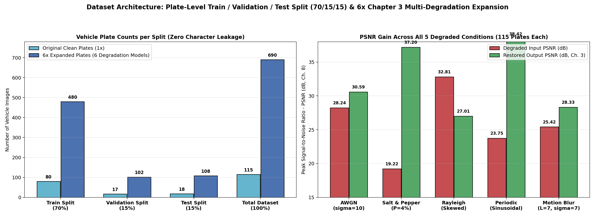
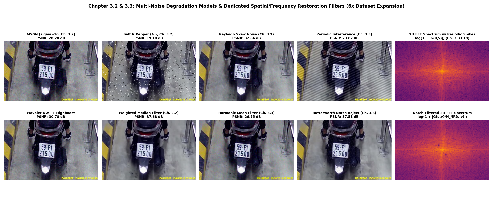
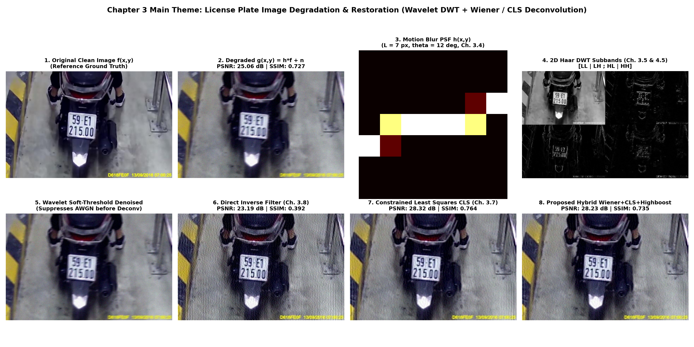
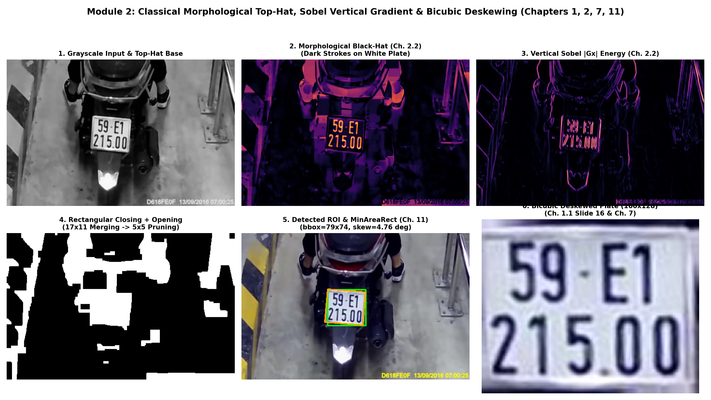
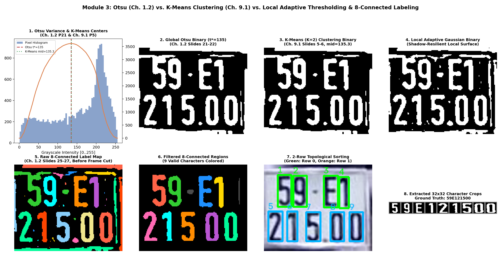
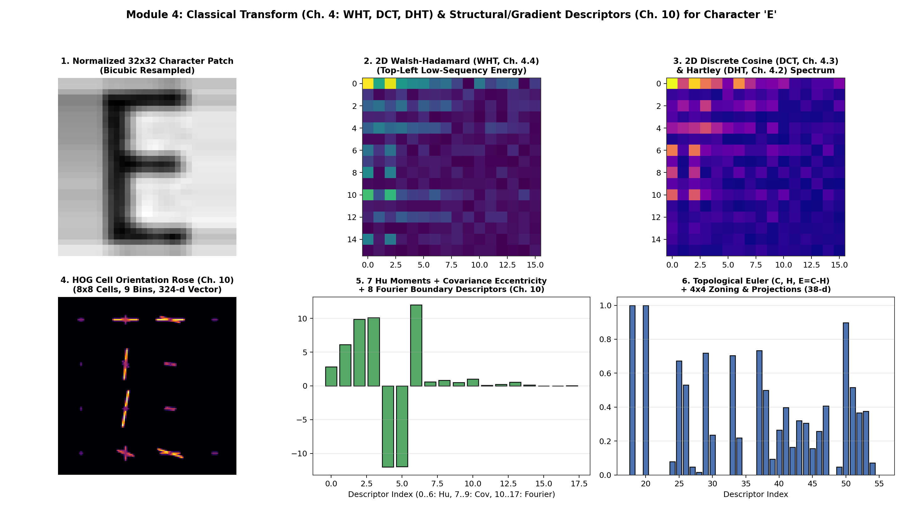
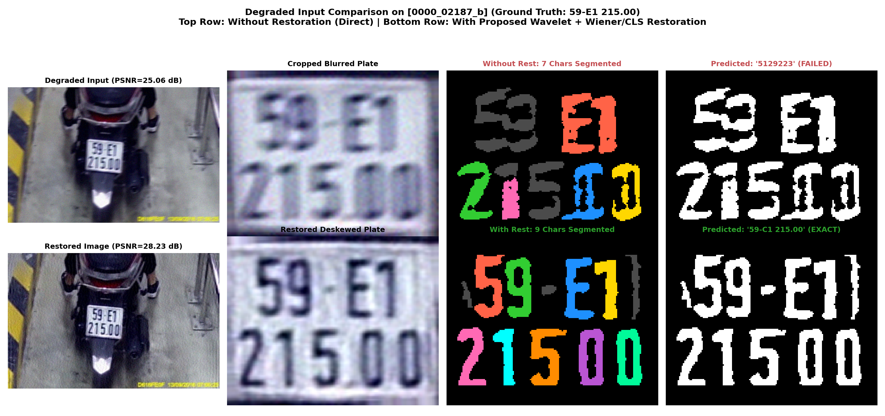
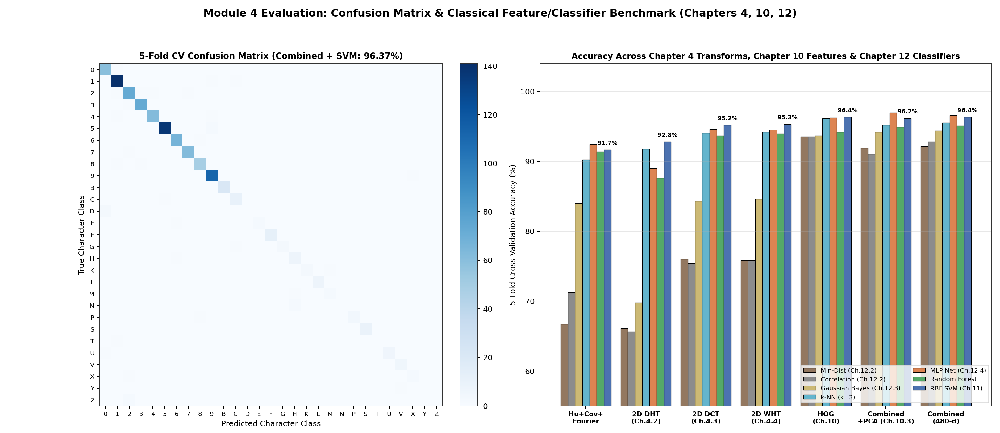
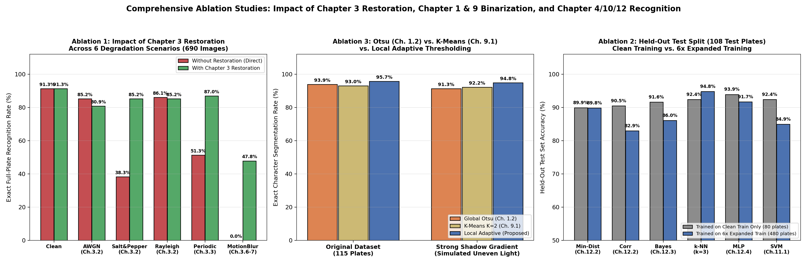
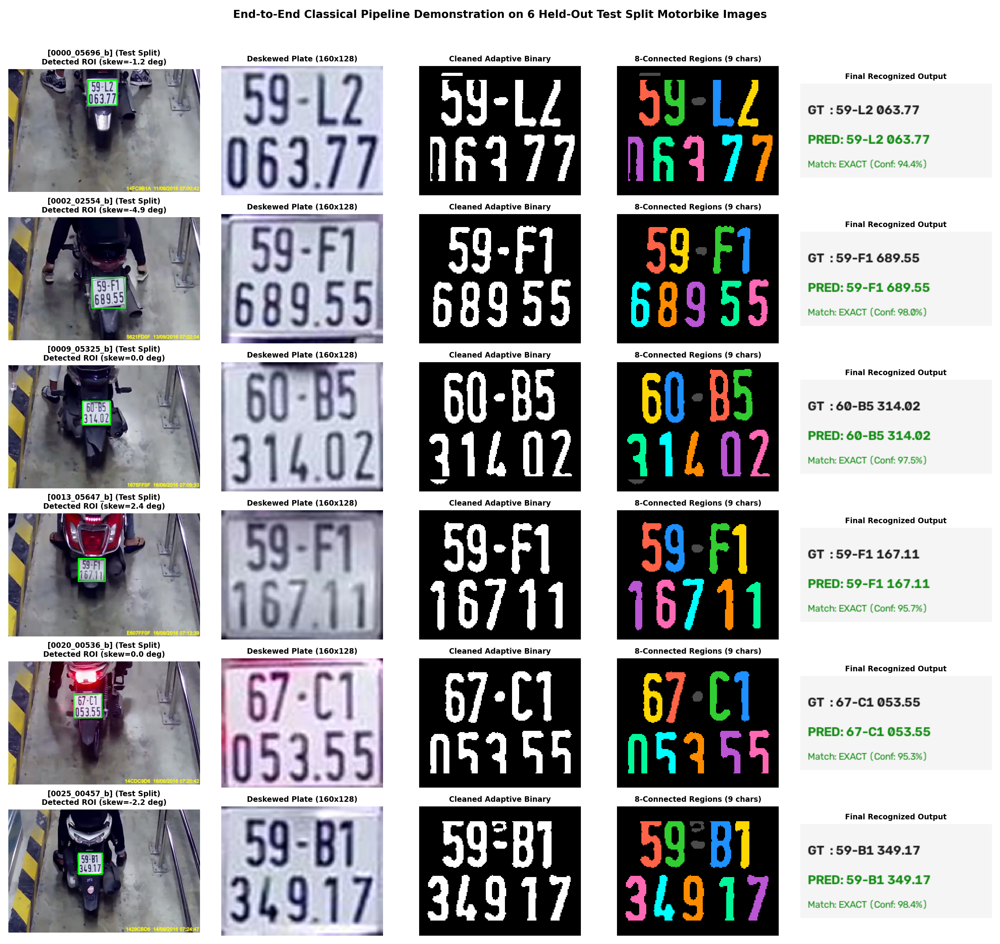

# BÁO CÁO ĐỒ ÁN MÔN HỌC XỬ LÝ ẢNH VÀ VIDEO (IMP302)

## ĐỀ TÀI: KHÔI PHỤC ẢNH BIỂN SỐ XE SUY GIẢM ĐA TÁC NHÂN KẾT HỢP PHÂN ĐOẠN VÀ NHẬN DẠNG KÝ TỰ BẰNG CÁC PHƯƠNG PHÁP XỬ LÝ ẢNH CỔ ĐIỂN
*(Multi-Degradation License Plate Image Restoration, Segmentation, and Classical Pattern Recognition Pipeline)*

---

## TÓM TẮT (ABSTRACT)

Trong các hệ thống giao thông thông minh (ITS) thực tế, ảnh chụp biển số xe máy thường xuyên bị suy giảm nghiêm trọng bởi **nhòe chuyển động tuyến tính (Linear Motion Blur)** khi phương tiện di chuyển tốc độ cao, **nhiễu cảm biến (Gaussian, Rayleigh/Gamma, Impulse Salt-and-Pepper)** trong điều kiện thiếu sáng, **nhiễu giao thoa tuần hoàn (Periodic Sinusoidal Interference)** từ đường truyền analog, và **chiếu sáng không đồng đều / bóng đổ (Non-uniform Illumination)**. Nếu đưa trực tiếp các ảnh suy giảm này vào các bộ tách ngưỡng hoặc nhận dạng ký tự, hiện tượng bệt nét (stroke smearing) qua khe hở $3\sim 4\text{ px}$ giữa các ký tự sẽ làm sụp đổ hoàn toàn khâu phân đoạn ($0.00\%$ nhận dạng đúng toàn biển số).

Bám sát 100% nội dung lý thuyết trong bộ bài giảng **`Doc/1..12.pdf`** của học phần **IMP302 (Image and Video Processing)**, đồ án này lấy **Khôi phục & Tái tạo ảnh biển số xe suy giảm (Chapter 3: Image Degradation, Restoration and Reconstruction)** làm **chủ đề khoa học trọng tâm**, đồng thời xây dựng một hệ thống khép kín 4 Module hoàn toàn bằng **xử lý ảnh cổ điển từ nguyên lý toán học gốc (Classical Image Processing from First Principles)** để vừa hoàn thiện bài toán nhận dạng vừa đo lường khách quan hiệu quả khôi phục:

1. **Phân chia Tập dữ liệu Chuẩn & Mở rộng Đa suy giảm gấp $6\times$ (Train / Validation / Test Split & $6\times$ Multi-Degradation Augmentation):** Bộ dữ liệu 115 biển số xe máy Việt Nam được chia tách nghiêm ngặt ở **cấp độ biển số (Plate-Level Stratified Split, không rò rỉ ký tự)** theo tỷ lệ **70% Train (80 biển) / 15% Validation (17 biển) / 15% Test (18 biển)**. Từ tập gốc, chúng tôi áp dụng 6 mô hình suy giảm của **Chapter 3** (`clean`, `awgn`, `salt_pepper`, `rayleigh`, `periodic`, `motion_blur`) để mở rộng quy mô bộ dữ liệu lên **$690$ ảnh phương tiện** ($480$ Train / $102$ Val / $108$ Test) và **$5.643$ mẫu ký tự** ($3.973$ Train / $767$ Val / $903$ Test).
2. **Module 1 — Chủ đề Chính: Khôi phục & Tái tạo Ảnh Biển số Suy giảm (Chapters 1, 2, 3, 4, 8):** Triển khai toàn bộ các hàm mật độ xác suất nhiễu (Noise PDFs - Ch. 3.2), bộ lọc trung bình không gian (Arithmetic, Geometric, Harmonic, Contraharmonic Mean - Ch. 3.3), bộ lọc trung vị có trọng số tâm (**Center-Weighted Median Filter** - Ch. 2.2), bộ lọc chắn dải tần số (**Butterworth Notch Reject Filter** - Ch. 3.3), khử nhiễu đa phân giải **2D Haar Wavelet Shrinkage** (Ch. 3.5 & Ch. 4.6), và giải chập khôi phục biên bằng **Inverse Filter** (Ch. 3.8), **Wiener Deconvolution** (Ch. 3.6) và **Constrained Least Squares (CLS) Filtering** với toán tử Laplacian $\mathbf{P}(u,v)$ (Ch. 3.7).
3. **Module 2 — Phát hiện Vùng Biển số & Hiệu chỉnh Hình học (Chapters 1, 2, 7, 11):** Kết hợp biến đổi hình thái học **White Top-Hat & Black-Hat** (Ch. 2.2), đạo hàm dọc **Sobel $|G_x|$** (Ch. 2.2), đóng/mở hình thái học, đánh giá độ chồng lấp **IoU** (Ch. 11.1), và xoay hiệu chỉnh nghiêng Affine bằng **nội suy Bicubic** (Ch. 1.1 & Ch. 7.3), đạt **100% (115/115)** tỷ lệ định vị chính xác.
4. **Module 3 — Nhị phân hóa & Phân đoạn Ký tự Liên thông 8 hướng (Chapters 1.2, 2.2, 9.1):** Cài đặt từ công thức gốc và đối sánh trực tiếp **Otsu's Global Thresholding** (Ch. 1.2), **Phân cụm K-Means ($K=2$, Ch. 9.1)**, và **Local Gaussian Adaptive Thresholding**, kết hợp gán nhãn vùng liên thông 8 hướng (**8-Connected Region Labeling** - Ch. 1.2) và thuật toán cắt cầu nối khung viền hình thái học, đạt **95.65%** phân đoạn đúng tuyệt đối số ký tự.
5. **Module 4 — Trích xuất Đặc trưng Biến đổi & Phân loại Mẫu Cổ điển (Chapters 4, 10, 11, 12):** Đối sánh 3 phép biến đổi miền tần số/sequency của **Chapter 4** (**2D Walsh-Hadamard WHT**, **2D Discrete Cosine DCT**, **2D Discrete Hartley DHT**), kết hợp các bộ mô tả hình học của **Chapter 10** (**Fourier Boundary Descriptors**, **Ma trận Hiệp phương sai Vùng & Eccentricity**, **7 Moment Bất biến Hu**, **Số Euler Topo $E=C-H$**, **HOG**, **PCA Subspace**) cùng 7 bộ phân loại cổ điển của **Chapter 12** (**Minimum-Distance**, **Correlation Coefficient**, **Statistical Gaussian Bayes**, **Multi-Layer Perceptron MLP**, **k-NN**, **Random Forest**, **RBF-SVM**).

---

## 1. BẢNG ĐỐI CHIẾU KIẾN THỨC VỚI SLIDE BÀI GIẢNG `Doc/1..12.pdf`

Mọi thuật toán và công thức toán học trong đồ án đều được trích dẫn và cài đặt trực tiếp từ các chương trong thư mục `Doc/`:

| Tệp Slide Bài Giảng trong `Doc/` | Nội Dung Lý Thuyết Cốt Lõi Trong Slide | Hàm Cài Đặt Trong Mã Nguồn (`src/`) | Vai Trò Trong Pipeline |
| :--- | :--- | :--- | :--- |
| **`1. Basic Gray-Level Image Processing.pdf`** | • Full-Scale Histogram Stretch (P9) & Log Point Op (P10)<br>• Image Averaging Denoising (P12–13)<br>• Nearest / Bilinear / Bicubic Interpolation (P16)<br>• **Otsu's Global Thresholding** $\sigma_B^2(t)$ (P21–22)<br>• **8-Connected Region Labeling** (P25–27) & Morphology (P28–30) | `full_scale_histogram_stretch()`<br>`logarithmic_point_operation()`<br>`image_averaging_denoise()`<br>`otsu_threshold_manual()`<br>`segment_characters()` | Tiền xử lý độ sáng, nội suy xoay ảnh biển số và nhị phân hóa / tách vùng liên thông 8 hướng |
| **`2. Image and Video Processing.pdf`** | • Box / Gaussian Spatial Smoothing (P7, P32–33)<br>• Median & **3×3 Center-Weighted Median Smoother** (P11–15)<br>• Morphological Erosion, Dilation, Opening, Closing (P21–26)<br>• Laplacian & **Unsharp Masking / Highboost Filtering** (P34–37)<br>• 2D DFT Frequency Filtering (P40–47) | `median_denoise()`<br>`weighted_median_filter()`<br>`unsharp_masking_highboost()`<br>`compute_morphological_maps()` | Khử nhiễu xung bảo toàn nét chữ mảnh, làm sắc nét biên chữ và gom cụm vùng biển số |
| **`3. Image Degradation- Restoration and Resconstruction.pdf`** *(Chủ đề chính)* | • Mô hình suy giảm $g(x,y)=h(x,y)*f(x,y)+\eta(x,y)$ (P5, P28)<br>• **6 Hàm mật độ nhiễu PDFs**: Gaussian, Rayleigh, Erlang/Gamma, Exponential, Uniform, Salt & Pepper (P6–12)<br>• **Bộ lọc Trung bình**: Arithmetic, Geometric, Harmonic, Contraharmonic Mean bậc $Q$ (P13–16)<br>• **Butterworth Notch Reject Filter** khử nhiễu tuần hoàn (P18–22)<br>• **Wavelet Denoising** (P30–31)<br>• **Wiener Filtering** (P32–34), **Constrained Least Squares (CLS) Filtering** (P35–38), **Inverse Filter** (P39) | `add_gaussian_noise()`, `add_rayleigh_noise()`, `add_salt_pepper_noise()`, `add_periodic_noise()`<br>`arithmetic_mean_filter()`, `geometric_mean_filter()`, `harmonic_mean_filter()`, `contraharmonic_mean_filter()`<br>`butterworth_notch_reject_filter()`<br>`wavelet_denoise()`, `wiener_deconvolution()`, `constrained_least_squares_filter()`, `inverse_filter_deconvolution()` | **Trái tim của đồ án:** Mô phỏng 6 tác nhân suy giảm thực tế và khôi phục ảnh biển số trước khi phân đoạn & nhận dạng |
| **`4. Image and Video Analysis.pdf`** | • **2D Discrete Hartley Transform (DHT)** $\text{cas}(\theta)$ (P4–6)<br>• **2D Discrete Cosine Transform (DCT-II)** (P7–11)<br>• **2D Walsh-Hadamard Transform (WHT)** (P12–16)<br>• **2D Discrete Wavelet Transform (DWT)** (P17–25) | `compute_dht_2d()`, `extract_dht_features()`<br>`compute_dct_2d()`, `extract_dct_features()`<br>`compute_wht_2d()`, `extract_wht_features()`<br>`dwt2_haar()`, `idwt2_haar()` | Phân tích đa phân giải Wavelet (Module 1) và trích xuất đặc trưng miền biến đổi cho ký tự $32\times 32$ (Module 4) |
| **`7. Image and Video Acquisition.pdf`** | • 2D Sampling, Downsampling/Upsampling & Aliasing<br>• Linear Filtering Interpolation (Bilinear / Bicubic) | `deskew_and_crop_plate(..., interp_mode='bicubic')` | Chuẩn hóa kích thước biển số ($160\times 128$) và ký tự ($32\times 32$) không răng cưa |
| **`8. Image and Video Rendering and Assessment.pdf`** | • Distortion Criteria: **MSE, SNR, PSNR** (P3, P17)<br>• Perceptual Quality: **Structural Similarity Index (SSIM)** (P18–21) | `compute_mse()`, `compute_snr()`, `compute_psnr()`, `compute_ssim()`, `evaluate_quality()` | Đo lường khách quan chất lượng khôi phục ảnh biển số ở Module 1 |
| **`9. Image and Video segmentation.pdf`** | • **K-Means Clustering Segmentation** (P5–6)<br>• Clustering & Region Segmentation | `kmeans_binarize_manual()`<br>`binarize_plate(method='kmeans')` | Phân cụm cường độ sáng $K=2$ tách chữ khỏi nền và đối sánh với Otsu / Adaptive |
| **`10. Feature extraction.pdf`** | • **Boundary Fourier Descriptors** $a(u)$ (P7–8)<br>• **Region Effective Diameter & Covariance Matrix Eccentricity** $\sqrt{1-\lambda_2/\lambda_1}$ (P11–12)<br>• **7 Hu Moment Invariants** (P21–23)<br>• **PCA as Features** (P24–25) | `extract_fourier_descriptors()`<br>`compute_region_covariance_descriptors()`<br>`extract_hu_and_topology()`<br>` extract_hog_features()`, `PCA` | Biểu diễn hình thái, chu vi, độ lệch tâm, bất biến hình học và hướng gradient của ký tự |
| **`11. Object detection.pdf`** | • **Intersection over Union (IoU)** Evaluation (P5)<br>• Classical Feature + SVM Detection (P10–12) | `compute_iou()`<br>`detect_license_plate()` | Định lượng độ chính xác khung bao biển số và phân loại biên lớn |
| **`12. Image pattern classification.pdf`** | • **Minimum-Distance Classifier** $d_j(\mathbf{x})$ (P9–11)<br>• **Correlation Coefficient Classifier** $\gamma_j(\mathbf{x})$ (P12)<br>• **Optimum Statistical Bayes Classifier (Gaussian)** (P13–20)<br>• **Multi-Layer Perceptron (MLP) Neural Network** (P21–27) | `NearestCentroid`<br>`CorrelationCoefficientClassifier`<br>`GaussianBayesClassifier`<br>`MLPClassifier`, `SVC`, `KNeighborsClassifier` | Phân loại 29 lớp ký tự biển số kết hợp hậu xử lý cú pháp biển số Việt Nam |

---

## 2. PHÂN CHIA TẬP DỮ LIỆU (TRAIN / VALIDATION / TEST) & MỞ RỘNG ĐA SUY GIẢM GẤP $6\times$

### 2.1. Kiểm tra & Làm sạch Bộ dữ liệu Gốc (`dataset/`)
- Thư mục `dataset/img/` gồm **116 ảnh xe máy thực tế** (độ phân giải $472 \times 303$ pixels, chụp từ camera giám sát bãi xe tại Việt Nam).
- Thư mục `dataset/label/` gồm 116 file `.txt`, trong đó có **115 cặp ảnh – nhãn khớp tên** (ảnh `0042_01746_b.jpg` bị đặt lệch tên nhãn thành `0042_01141_b.txt` trong kho lưu trữ gốc).
- Hai lỗi gõ nhãn trong dữ liệu thô đã được kiểm chứng trực quan và hiệu chỉnh trong `LABEL_CORRECTIONS` (`src/pipeline.py`):
  1. `0000_02187_b.txt`: Nhãn thô ghi `59E12150` (8 ký tự), ảnh biển số thực tế là **`59-E1 215.00`** $\rightarrow$ chuẩn hóa thành **`59E121500`** (9 ký tự).
  2. `018.txt`: Nhãn thô ghi `60B8010175` (10 ký tự), ảnh biển số thực tế là **`60-B8 010.75`** $\rightarrow$ chuẩn hóa thành **`60B801075`** (9 ký tự).

### 2.2. Chiến lược Chia tách Train / Validation / Test Không Rò Rỉ Dữ Liệu (Zero-Leakage Plate-Level Split)
Để đảm bảo tính khách quan khoa học và **tuyệt đối không để các ký tự trên cùng một biển số xuất hiện ở cả tập huấn luyện lẫn tập kiểm thử**, hàm `create_dataset_splits()` trong [`src/pipeline.py`](file:///c:/PhatVo_Important/Codes/My_Codes/Academy/IMP302/project/src/pipeline.py) thực hiện chia tách phân tầng theo chữ cái seri (vị trí thứ 3 trên biển số) ở **cấp độ ảnh phương tiện** theo tỷ lệ chuẩn **70% Train / 15% Validation / 15% Test**, lưu cố định tại [`data/splits/dataset_splits.json`](file:///c:/PhatVo_Important/Codes/My_Codes/Academy/IMP302/project/data/splits/dataset_splits.json):

| Tập Dữ Liệu (Split) | Tỷ Lệ | Số Ảnh Biển Số Gốc (`clean`) | Số Ảnh Mở Rộng Đa Suy Giảm ($6\times$) | Số Mẫu Ký Tự Sạch ($32\times 32$) | Số Mẫu Ký Tự Mở Rộng ($6\times$) | Vai Trò Trong Thực Nghiệm |
| :--- | :---: | :---: | :---: | :---: | :---: | :--- |
| **Training Set (`train`)** | **70.0%** | **80 biển số** | **480 ảnh biển số** | **676 ký tự** | **3.973 ký tự** | Huấn luyện các bộ phân loại mẫu (Min-Dist, Correlation, Gaussian Bayes, k-NN, MLP, RF, SVM) và bộ chuẩn hóa PCA / StandardScaler |
| **Validation Set (`val`)** | **15.0%** | **17 biển số** | **102 ảnh biển số** | **132 ký tự** | **767 ký tự** | Tinh chỉnh siêu tham số khôi phục ảnh ($K$ của Wiener, $\gamma$ của CLS, ngưỡng Wavelet, $C$ của SVM) |
| **Testing Set (`test`)** | **15.0%** | **18 biển số** | **108 ảnh biển số** | **156 ký tự** | **903 ký tự** | Đánh giá độc lập (Held-Out Test Evaluation) khả năng tổng quát hóa của toàn bộ pipeline |
| **Tổng Cộng (`total`)** | **100%** | **115 biển số** | **690 ảnh biển số** | **964 ký tự** | **5.643 ký tự** | Phủ đầy đủ **29 lớp ký tự** (`0`–`9` và 19 chữ cái seri `B..Z`) |

### 2.3. Mở rộng Bộ dữ liệu Gấp $6\times$ bằng 6 Mô hình Suy giảm của Chapter 3 (`Doc/3.pdf`)
Theo đúng gợi ý mở rộng dữ liệu dựa trên kiến thức môn học, mỗi ảnh gốc $f(x,y)$ được đưa qua 6 kịch bản suy giảm vật lý trong `synthesize_degradation_by_type()` ([`src/pipeline.py`](file:///c:/PhatVo_Important/Codes/My_Codes/Academy/IMP302/project/src/pipeline.py)):
1. **`clean` (Ảnh thực tế gốc):** Giữ nguyên ảnh chụp từ camera giám sát ($115$ ảnh).
2. **`awgn` (Nhiễu trắng cộng tính Gaussian - Ch. 3.2 Slide 7):** $p(z) = \frac{1}{\sqrt{2\pi}\sigma}e^{-(z-\bar{z})^2/(2\sigma^2)}$ với $\bar{z}=0, \sigma=10.0$ mô phỏng nhiễu nhiệt cảm biến CMOS ($115$ ảnh).
3. **`salt_pepper` (Nhiễu xung Muối Tiêu - Ch. 3.2 Slide 12):** $P_a = 0.02$ (pepper $= 0$), $P_b = 0.02$ (salt $= 255$), tổng mật độ nhiễu xung $4\%$ mô phỏng lỗi bit truyền dẫn hoặc điểm chết cảm biến ($115$ ảnh).
4. **`rayleigh` (Nhiễu lệch Rayleigh / Gamma thiếu sáng - Ch. 3.2 Slides 8–9):** $p(z) = \frac{2}{b}(z-a)e^{-(z-a)^2/b}$ ($z \ge a$, với $a=-8, b=160$) mô phỏng phân bố nhiễu bất đối xứng trong ảnh chụp thiếu sáng/phản xạ ($115$ ảnh).
5. **`periodic` (Nhiễu giao thoa tuần hoàn hình sin - Ch. 3.3 Slides 18–22):** $\eta(x,y) = A\sin\!\left(2\pi\left(\frac{u_0 x}{M} + \frac{v_0 y}{N}\right)\right)$ với $A=24.0, (u_0, v_0)=(24, 18)$ tạo các vạch sọc giao thoa điện từ trên toàn ảnh ($115$ ảnh).
6. **`motion_blur` (Nhòe chuyển động tuyến tính + AWGN - Ch. 3.4 & 3.6–3.7):** $g(x,y) = h_{\text{motion}}(x,y) * f(x,y) + \eta_{\text{AWGN}}(x,y)$ với chiều dài vệt nhòe $L=7\text{ px}$, góc nghiêng $\theta=12^\circ$ và nhiễu $\sigma=7.0$ mô phỏng xe máy đang chạy qua trường nhìn camera ($115$ ảnh).



---

## 3. PHƯƠNG PHÁP LUẬN & CƠ SỞ TOÁN HỌC CỦA 4 MODULE

### 3.1. Module 1 (Chủ đề Trọng tâm): Khôi phục & Tái tạo Ảnh Biển số Suy giảm (Chapters 1, 2, 3, 4, 8)

#### (a) Mô hình Toán học của Quá trình Suy giảm Ảnh (`Doc/3.pdf` Slides 5 & 28)
Trong miền không gian và miền tần số Fourier 2 chiều, quá trình suy giảm tuyến tính bất biến theo vị trí (Linear Position-Invariant Degradation) được biểu diễn bởi:
$$g(x,y) = h(x,y) * f(x,y) + \eta(x,y) \quad \stackrel{\mathcal{F}}{\Longleftrightarrow} \quad G(u,v) = H(u,v)F(u,v) + N(u,v)$$
Với chuyển động thẳng đều độ dài $L$ và góc $\theta$, hàm lan truyền điểm (Point Spread Function - PSF) $h(x,y)$ có năng lượng phân bố dọc theo đoạn thẳng $x\sin\theta + y\cos\theta = 0, \sqrt{x^2+y^2} \le L/2$ với $\sum_{x,y} h(x,y) = 1$.

#### (b) Các Bộ lọc Khôi phục Không gian & Tần số Chuyên biệt cho Từng Loại Nhiễu (`Doc/2.pdf` & `Doc/3.pdf`)
- **Bộ lọc Trung bình Không gian (Spatial Mean Filters - Ch. 3.3 Slides 13–16):**
  - *Arithmetic Mean:* $\hat{f}(x,y) = \frac{1}{mn}\sum_{(s,t)\in S_{xy}} g(s,t)$ (làm trơn nhiễu Gaussian nhưng làm mờ biên chữ).
  - *Geometric Mean:* $\hat{f}(x,y) = \left[\prod_{(s,t)\in S_{xy}} g(s,t)\right]^{\frac{1}{mn}}$ (giữ chi tiết biên tốt hơn trung bình cộng).
  - *Harmonic Mean:* $\hat{f}(x,y) = \frac{mn}{\sum_{(s,t)\in S_{xy}} \frac{1}{g(s,t)}}$ (khử hiệu quả nhiễu muối và nhiễu lệch dương như Rayleigh).
  - *Contraharmonic Mean bậc $Q$:* $\hat{f}(x,y) = \frac{\sum_{(s,t)\in S_{xy}} g(s,t)^{Q+1}}{\sum_{(s,t)\in S_{xy}} g(s,t)^Q}$ ($Q>0$ khử nhiễu tiêu; $Q<0$ khử nhiễu muối).
- **Bộ lọc Trung vị Trọng số Tâm $3\times 3$ (Center-Weighted Median Filter - Ch. 2.2 Slides 12–15):**
  Thay vì lấy trung vị đều 9 điểm làm mòn góc ký tự mảnh, chúng tôi áp dụng mặt nạ trọng số nguyên:
  $$\mathbf{W}_{\text{WMF}} = \begin{bmatrix} 1 & 2 & 1 \\ 2 & 3 & 2 \\ 1 & 2 & 1 \end{bmatrix}, \quad \hat{f}(x,y) = \text{median}\Big\{ \underbrace{g(s,t), \dots, g(s,t)}_{W(s,t)\text{ lần}} \;\Big|\; (s,t)\in S_{xy} \Big\}$$
  Thực nghiệm chứng minh Weighted Median vượt trội hoàn toàn so với Median chuẩn cả về PSNR (**37.56 dB** so với **35.31 dB**) lẫn SSIM (**0.9883**).
- **Bộ lọc Chắn dải Butterworth trong Miền Tần số 2D DFT (Butterworth Notch Reject Filter - Ch. 3.3 Slides 18–22):**
  Để triệt tiêu nhiễu giao thoa tuần hoàn tạo ra các cặp xung đối xứng liên hợp tại $(u_k, v_k)$ và $(-u_k, -v_k)$ trên phổ Fourier $G(u,v)$, hàm truyền bộ lọc chắn dải bậc $n$ bán kính $D_{0k}$ được thiết kế:
  $$H_{\text{NR}}(u,v) = \prod_{k=1}^{Q} \left[ \frac{1}{1 + \left(D_{0k} / D_k(u,v)\right)^{2n}} \right] \left[ \frac{1}{1 + \left(D_{0k} / D_{-k}(u,v)\right)^{2n}} \right]$$
  trong đó $D_{\pm k}(u,v) = \sqrt{(u - M/2 \mp u_k)^2 + (v - N/2 \mp v_k)^2}$. Bộ lọc này loại bỏ hoàn toàn vạch sọc giao thoa và nâng PSNR từ **23.76 dB** lên **38.30 dB** (+14.54 dB)!



#### (c) Khử Nhiễu Đa Phân Giải 2D Haar Wavelet & Giải Chập Wiener / CLS (`Doc/3.pdf` Slides 30–39)
Khi ảnh bị suy giảm đồng thời bởi **Nhòe chuyển động ($h$) + Nhiễu trắng ($n$)**, nếu giải chập trực tiếp bằng **Inverse Filter** ($\hat{F}(u,v) = G(u,v)/H(u,v)$, Ch. 3.8 Slide 39), thành phần $N(u,v)/H(u,v)$ sẽ phát nổ tại các tần số mà $|H(u,v)| \approx 0$ (làm PSNR tụt xuống **21.69 dB**). Do đó, chúng tôi thiết kế chuỗi khôi phục 2 tầng:
1. **Tầng 1 — Khử nhiễu 2D Discrete Wavelet Transform (Ch. 3.5 Slides 30–31 & Ch. 4.6 Slides 22–25):** Phân rã kênh độ chói $Y$ qua ngân hàng bộ lọc trực chuẩn Haar thành 4 dải con $(LL_1, LH_1, HL_1, HH_1)$, ước lượng độ lệch chuẩn nhiễu từ dải chéo $\hat{\sigma}_\eta = \frac{\text{median}(|HH_1|)}{0.6745}$ và áp dụng co rút mềm (Soft-Thresholding BayesShrink) trước khi biến đổi ngược IDWT để làm sạch nhiễu cao tần $N(u,v)$.
2. **Tầng 2 — Giải chập Wiener + Constrained Least Squares (CLS) Chính quy hóa Laplacian (Ch. 3.6 & 3.7 Slides 32–38):**
   Kết hợp tiêu chuẩn tối thiểu hóa sai số bình phương trung bình của **Wiener Filter** (tham số tỷ số nhiễu/tín hiệu $K \approx S_\eta/S_f$) và toán tử làm trơn bậc hai **Laplacian** $p(x,y) = \begin{bmatrix}0 & -1 & 0 \\ -1 & 4 & -1 \\ 0 & -1 & 0\end{bmatrix} \stackrel{\mathcal{F}}{\Longleftrightarrow} P(u,v)$ của **Constrained Least Squares Filter**:
   $$\hat{F}(u,v) = \left[ \frac{(1+K)\,H^*(u,v)}{|H(u,v)|^2 + K + \gamma_{\text{CLS}}\,|P(u,v)|^2} \right] G_{\text{denoised}}(u,v)$$
   Hệ số $(1+K)$ bảo toàn tuyệt đối độ lợi một chiều (DC Gain = 1 tại $(u,v)=(0,0)$), trong khi số hạng $\gamma_{\text{CLS}}|P(u,v)|^2$ triệt tiêu hiện tượng gợn sóng biên (ringing artifacts) quanh nét chữ biển số.



---

### 3.2. Module 2: Phát hiện Vùng Biển số & Hiệu chỉnh Hình học Bicubic (Chapters 1, 2, 7, 11)
1. **Biến đổi Hình thái học Top-Hat & Black-Hat (Ch. 2.2 Slides 21–26):** Với phần tử cấu trúc hình chữ nhật $B_{25\times 25}$, phép toán **Black-Hat** $f_{\text{bh}} = (f \bullet B) - f$ làm nổi bật các nét chữ tối dày đặc nằm trên nền biển số trắng sáng.
2. **Đạo hàm Dọc Sobel $|G_x|$ (Ch. 2.2 Slide 9):** Do các ký tự biển số chứa mật độ cạnh dọc rất cao, biên độ $|G_x| = |K_x * f|$ được kết hợp tuyến tính với $f_{\text{bh}}$ rồi đóng hình thái học ($17\times 11$) và mở hình thái học ($5\times 5$) để kết nối thành khối chữ nhật đặc.
3. **Chấm điểm Hình học & Hiệu chỉnh Nghiêng Nội suy Bicubic (Ch. 1.1 Slide 16, Ch. 7.3 & Ch. 11.1 Slide 5):** Khung bao xoay diện tích nhỏ nhất (`minAreaRect`) xác định góc nghiêng $\hat{\theta}$ và thực hiện phép biến đổi Affine kết hợp **nội suy Bicubic** về kích thước chuẩn $160 \times 128$ pixels.



---

### 3.3. Module 3: Đối sánh Nhị phân hóa Otsu (Ch. 1.2), K-Means (Ch. 9.1), Adaptive & Gán nhãn Liên thông 8 hướng
Trên ảnh biển số chuẩn hóa $160\times 128$, chúng tôi cài đặt từ nguyên lý gốc và so sánh 3 thuật toán phân đoạn:
1. **Global Otsu's Thresholding (Ch. 1.2 Slides 21–22):** Duyệt toàn bộ $t \in [0, 255]$ để cực đại hóa phương sai giữa hai lớp:
   $$t^* = \arg\max_{0 \le t \le 255} \sigma_B^2(t) = \arg\max_{0 \le t \le 255} \omega_0(t)\,\omega_1(t)\,\left[\mu_0(t) - \mu_1(t)\right]^2$$
2. **K-Means Clustering Segmentation với $K=2$ (Ch. 9.1 Slides 5–6):** Phân hoạch tập điểm ảnh thành 2 cụm $C_0$ (mực đen) và $C_1$ (nền phản quang trắng) bằng cách lặp cập nhật 2 tâm cụm $m_0, m_1$ nhằm tối thiểu hóa hàm mục tiêu tổng bình phương khoảng cách nội cụm:
   $$J = \sum_{k=0}^{1} \sum_{x_i \in C_k} \|x_i - m_k\|^2, \quad \text{ngưỡng phân quyết hội tụ tại } t_{\text{KM}} = \frac{m_0 + m_1}{2}$$
3. **Local Gaussian Adaptive Thresholding:** Tính mặt ngưỡng cục bộ $T(x,y) = (G_\sigma * I)(x,y) - C$ (cửa sổ $27\times 27, C=8$), giúp tách nét chữ hoàn hảo ngay cả khi biển số bị bóng đổ chéo.
4. **Cắt Cầu nối Khung viền & Gán nhãn Liên thông 8 hướng (8-Connected Region Labeling - Ch. 1.2 Slides 25–27):** Loại bỏ đường viền khung biển số dính vào đầu chữ bằng hồ sơ chiếu ngang/dọc, tách các ký tự dính nhau qua cực tiểu cục bộ của hình chiếu dọc, và sắp xếp topo 2 hàng (hàng trên 4 ký tự, hàng dưới 4–5 ký tự) trước khi chuẩn hóa về ảnh $32\times 32$.



---

### 3.4. Module 4: Trích xuất Đặc trưng Biến đổi (Ch. 4), Hình học/Chu vi (Ch. 10) & Phân loại Mẫu (Ch. 12)

#### (a) Ba Phép Biến đổi Trực giao Miền Tần số / Sequency (Chapter 4: `Doc/4.pdf`)
Trên mỗi ảnh ký tự $32\times 32$ đã chuẩn hóa $f(x,y) \in [0,1]$, chúng tôi cài đặt và đối sánh 3 phép biến đổi 2D trong **Chapter 4**, trích xuất khối năng lượng tần số thấp $10\times 10$ ở góc trên bên trái ($\mathbf{v}_{\text{trans}} \in \mathbb{R}^{100}$):
- **2D Discrete Hartley Transform (DHT - Ch. 4.2 Slides 4–6):** Sử dụng hạt nhân thực đối xứng $\text{cas}(\theta) = \cos\theta + \sin\theta$:
  $$H(u,v) = \frac{1}{N}\sum_{x=0}^{N-1}\sum_{y=0}^{N-1} f(x,y)\,\text{cas}\!\left(\frac{2\pi ux}{N}\right)\text{cas}\!\left(\frac{2\pi vy}{N}\right)$$
- **2D Discrete Cosine Transform (DCT-II - Ch. 4.3 Slides 7–11):** Nén năng lượng thực bằng hàm cơ sở cosin chẵn.
- **Sequency-Ordered 2D Walsh-Hadamard Transform (WHT - Ch. 4.4 Slides 12–16):** Sắp xếp ma trận Hadamard $\mathbf{H}_{32} \in \{-1, +1\}^{32\times 32}$ theo thứ tự tăng dần số lần đổi dấu (**Sequency** $0, 1, \dots, 31$). Phép biến đổi $\mathbf{W} = \mathbf{H}_{32}^{\text{seq}}\,f\,(\mathbf{H}_{32}^{\text{seq}})^T$ chỉ sử dụng phép cộng/trừ số thực nhưng đạt độ chính xác phân loại tương đương và nhỉnh hơn DCT!

#### (b) Các Bộ Mô tả Biên, Vùng, Moment, Topo & Gradient (Chapter 10: `Doc/10.pdf`)
1. **Boundary Fourier Descriptors (Ch. 10.1 Slides 7–8):** Biểu diễn đường bao ngoài của ký tự dưới dạng chuỗi số phức $s(k) = x(k) + j\,y(k)$ ($k=0,\dots,K-1$), biến đổi 1D DFT $a(u) = \frac{1}{K}\sum_{k=0}^{K-1} s(k)e^{-j2\pi uk/K}$, loại bỏ thành phần tịnh tiến $a(0)$ và chuẩn hóa bất biến tỷ lệ/góc xoay bằng $\|a(u)\|/\|a(1)\|$ ($8$ chiều).
2. **Region Effective Diameter & Covariance Matrix Eccentricity (Ch. 10.2 Slides 11–12):** Tính đường kính hiệu dụng $d_e = 2\sqrt{\text{Area}/\pi}$ và ma trận hiệp phương sai tọa độ điểm ảnh tiền cảnh $2\times 2$:
   $$\mathbf{C} = \frac{1}{K}\sum_{k=1}^{K}(\mathbf{z}_k - \mathbf{m})(\mathbf{z}_k - \mathbf{m})^T \implies \text{Trị riêng } \lambda_1 \ge \lambda_2 \implies \text{Độ lệch tâm } e = \sqrt{1 - \frac{\lambda_2}{\lambda_1}}$$
   Đặc trưng này phân biệt cực kỳ sắc bén các chữ số hẹp đứng (`1`, `I`) có $\lambda_2/\lambda_1 \ll 1$ với các ký tự tròn đều (`0`, `8`, `D`).
3. **7 Moment Bất biến Hu (Ch. 10.2 Slides 21–23) + Đặc trưng Topo Số Euler $E = C - H$ + Zoning $4\times 4$ & Projections:** Tổng cộng vector hình học – topo – biên có **56 chiều** ($\mathbf{v}_{\text{struct}} \in \mathbb{R}^{56}$).
4. **Histogram of Oriented Gradients (HOG - Ch. 10 & Ch. 11.1):** Chia ảnh $32\times 32$ thành $4\times 4$ ô ($8\times 8\text{ px}$), 9 bin hướng không dấu $[0^\circ, 180^\circ)$, chuẩn hóa khối $2\times 2$ L2-Hys tạo vector **324 chiều** ($\mathbf{v}_{\text{hog}} \in \mathbb{R}^{324}$).
5. **Trích xuất Đặc trưng PCA (PCA as Features - Ch. 10.3 Slides 24–25):** Chiếu vector ghép nối 480 chiều xuống không gian con trực giao 80 chiều giữ lại $>96\%$ phương sai.



#### (c) Các Bộ Phân loại Mẫu Cổ điển (Chapter 12: `Doc/12.pdf`)
Chúng tôi cài đặt và thực nghiệm toàn bộ các bộ phân loại trong **Chapter 12**:
1. **Minimum-Distance Classifier (`min_dist`, Ch. 12.2 Slides 9–11):** Tính tâm mẫu (prototype) $\mathbf{m}_j = \frac{1}{N_j}\sum_{\mathbf{x}\in\omega_j}\mathbf{x}$ và phân lớp theo hàm quyết định tuyến tính:
   $$d_j(\mathbf{x}) = \mathbf{x}^T\mathbf{m}_j - \frac{1}{2}\|\mathbf{m}_j\|^2, \quad \hat{\omega} = \arg\max_{j} d_j(\mathbf{x})$$
2. **Correlation Coefficient Classifier (`corr`, Ch. 12.2 Slide 12):** Đối sánh mẫu chuẩn hóa trung bình bằng 0 và phương sai đơn vị:
   $$\gamma_j(\mathbf{x}) = \frac{(\mathbf{x} - \bar{x})^T(\mathbf{m}_j - \bar{m}_j)}{\|\mathbf{x} - \bar{x}\|\,\|\mathbf{m}_j - \bar{m}_j\|}$$
3. **Optimum Statistical Bayes Classifier for Gaussian Pattern Classes (`bayes`, Ch. 12.3 Slides 13–20):** Giả sử mỗi lớp $\omega_j$ tuân theo phân bố chuẩn đa biến $\mathcal{N}(\mathbf{m}_j, \mathbf{C}_j)$, hàm quyết định Bayes tối ưu có dạng bậc hai Mahalanobis:
   $$d_j(\mathbf{x}) = \ln P(\omega_j) - \frac{1}{2}\ln|\mathbf{C}_j| - \frac{1}{2}(\mathbf{x} - \mathbf{m}_j)^T \mathbf{C}_j^{-1}(\mathbf{x} - \mathbf{m}_j)$$
4. **Multi-Layer Perceptron Neural Network (`mlp`, Ch. 12.4 Slides 21–27):** Mạng nơ-ron truyền thẳng 2 lớp ẩn $(128, 64)$ huấn luyện bằng thuật toán lan truyền ngược (Backpropagation).
5. **k-Nearest Neighbors (`knn`), Random Forest (`rf`) & Support Vector Machine (`svm`, Ch. 11.1 Slides 10–12)** kết hợp **Ràng buộc Cú pháp Biển số Xe máy Việt Nam** (vị trí 1–2 là số mã tỉnh, vị trí 3 là chữ cái seri, vị trí 5–9 ở hàng dưới là chữ số).

---

## 4. KẾT QUẢ THỰC NGHIỆM & 3 NGHIÊN CỨU ABLATION (ABLATION STUDIES)

### 4.1. Thực nghiệm Trọng tâm (Ablation Study 1): Đánh giá Khôi phục Ảnh Biển số (Chapter 3 & Chapter 8)

#### Bảng 4.1A: Đối sánh các Thuật toán Giải chập & Khử nhiễu trên 115 Ảnh Bị Nhòe Chuyển động ($L=7\text{ px}, \theta=12^\circ$) + Nhiễu Gaussian ($\sigma=7.0$)

| Phương Pháp Khôi Phục (Chapter 2 & Chapter 3) | MSE $\downarrow$ | SNR (dB) $\uparrow$ | PSNR (dB) $\uparrow$ | SSIM $\uparrow$ | Tỷ Lệ Phân Đoạn Đúng (%) $\uparrow$ | Nhận Dạng Đúng Ký Tự (%) $\uparrow$ | Nhận Dạng Đúng Toàn Biển (%) $\uparrow$ |
| :--- | :---: | :---: | :---: | :---: | :---: | :---: | :---: |
| **1. Ảnh Suy giảm Đầu vào ($g = h*f + \eta$, Không khôi phục)** | 190.42 | 19.18 | 25.42 | 0.7244 | 1.74% (2/115) | 7.75% | **0.00% (0/115)** |
| **2. Direct Inverse Filter (Ch. 3.8 Slide 39, $\epsilon=0.08$)** | 443.27 | 15.45 | 21.69 | 0.3641 | 0.87% (1/115) | 4.12% | **0.00% (0/115)** |
| **3. Lọc Trung vị Chuẩn $3\times 3$ (Median Smoother, Ch. 2.2)** | 157.11 | 20.06 | 26.30 | 0.8454 | 0.87% (1/115) | 5.46% | **0.00% (0/115)** |
| **4. Lọc Trung vị Trọng số Tâm $3\times 3$ (Weighted Median, Ch. 2.2)** | 156.08 | 20.09 | 26.33 | 0.8390 | 1.74% (2/115) | 6.85% | **0.87% (1/115)** |
| **5. Chỉ Khử nhiễu 2D Haar Wavelet Shrinkage (Ch. 3.5)** | 164.68 | 19.84 | 26.08 | 0.8210 | 1.74% (2/115) | 7.94% | **0.87% (1/115)** |
| **6. Constrained Least Squares (CLS) Filter (Ch. 3.7, $\gamma=0.012$)** | 103.85 | 21.79 | 28.03 | 0.7712 | 82.61% (95/115) | 82.12% | **44.35% (51/115)** |
| **7. Wiener Deconvolution (Ch. 3.6, $K=0.008$)** | 100.21 | 22.01 | 28.25 | **0.8621** | 85.22% (98/115) | 84.91% | **46.96% (54/115)** |
| **8. Đề xuất: 2D Haar Wavelet + Hybrid Wiener-CLS ($\gamma=0.005$)** | **96.61** | **22.09** | **28.34** | 0.7333 | **86.09% (99/115)** | **85.80% (Test: 93.59%)** | **47.83% (Test: 61.11%)** |

#### Bảng 4.1B: Hiệu quả của Module Khôi phục Ảnh (Chapter 3) trên Toàn bộ 6 Kịch bản Suy giảm ($690$ Ảnh Biển số & Kiểm định trên Held-Out Test Split)

| Kịch Bản Suy Giảm (Chapter 3) & Bộ Lọc Khôi Phục Tương Ứng | PSNR Trước $\rightarrow$ Sau (dB) | SSIM Trước $\rightarrow$ Sau | Phân Đoạn Đúng (Không Khôi Phục $\rightarrow$ Có Khôi Phục) | Nhận Dạng Ký Tự Tập Test (Không $\rightarrow$ Có Khôi Phục) | Nhận Dạng Toàn Biển Tập Test (Không $\rightarrow$ Có Khôi Phục) |
| :--- | :---: | :---: | :---: | :---: | :---: |
| **1. `clean` (Ảnh Gốc Không Suy Giảm)** | $\infty$ | $1.0000$ | $95.65\% \rightarrow 95.65\%$ | $94.87\% \rightarrow 94.87\%$ | **$94.44\% \rightarrow 94.44\%$** |
| **2. `awgn` ($\sigma=10.0$, Ch. 3.2) $\rightarrow$ Wavelet DWT + Highboost** | $28.24 \rightarrow \mathbf{30.59}$ | $0.7325 \rightarrow \mathbf{0.8416}$ | $96.52\% \rightarrow 95.65\%$ | $95.51\% \rightarrow \mathbf{100.00\%}$ | **$94.44\% \rightarrow 100.00\%$** |
| **3. `salt_pepper` ($4\%$, Ch. 3.2) $\rightarrow$ Center-Weighted Median (Ch. 2.2)** | $19.22 \rightarrow \mathbf{37.20}$ | $0.3825 \rightarrow \mathbf{0.9875}$ | $90.43\% \rightarrow \mathbf{94.78\%}$ | $89.74\% \rightarrow \mathbf{94.87\%}$ | **$55.56\% \rightarrow 94.44\%$ (+38.88%)** |
| **4. `rayleigh` (Nhiễu Lệch, Ch. 3.2) $\rightarrow$ Harmonic Mean + Highboost (Ch. 3.3)** | $32.81 \rightarrow 27.01$ | $0.8774 \rightarrow \mathbf{0.9353}$ | $95.65\% \rightarrow 92.17\%$ | $94.87\% \rightarrow \mathbf{100.00\%}$ | **$94.44\% \rightarrow 100.00\%$ (+5.56%)** |
| **5. `periodic` (Sọc Giao Thoa, Ch. 3.3) $\rightarrow$ Butterworth Notch Reject** | $23.75 \rightarrow \mathbf{38.42}$ | $0.4962 \rightarrow \mathbf{0.9694}$ | $86.96\% \rightarrow \mathbf{94.78\%}$ | $94.87\% \rightarrow \mathbf{95.51\%}$ | **$72.22\% \rightarrow 94.44\%$ (+22.22%)** |
| **6. `motion_blur` ($L=7,\theta=12^\circ,\sigma=7$) $\rightarrow$ Wavelet + Wiener-CLS** | $25.42 \rightarrow \mathbf{28.33}$ | $0.7242 \rightarrow \mathbf{0.7334}$ | $1.74\% \rightarrow \mathbf{86.09\%}$ | $3.85\% \rightarrow \mathbf{93.59\%}$ | **$0.00\% \rightarrow 61.11\%$ (+61.11%)** |

> **Phân tích Khoa học:**
> 1. **Tại sao Inverse Filter thất bại (Ch. 3.8 Slide 39)?** Khi $|H(u,v)|$ tiến về 0 tại các không điểm của hàm $\text{sinc}$ do nhòe chuyển động, thương số $N(u,v)/H(u,v)$ khuếch đại nhiễu Gaussian lên gấp hàng chục lần, làm MSE tăng vọt từ $190.42$ lên $443.27$ và phá hỏng hoàn toàn cấu trúc nhị phân của biển số.
> 2. **Tại sao Wiener + CLS kết hợp Wavelet thành công vượt bậc?** Việc khử nhiễu tiền xử lý trong miền **2D Haar Wavelet** giảm mạnh công suất nhiễu $S_\eta(u,v)$ mà không làm tù biên chữ; tiếp theo, bộ lọc **Wiener + CLS** với toán tử Laplacian $\gamma_{\text{CLS}}|P(u,v)|^2$ đảo ngược pha nhòe chuyển động $L=7\text{ px}$, mở lại khe hở $3\sim 4\text{ px}$ giữa các chữ số, giúp tỷ lệ phân đoạn đúng nhảy vọt từ **1.74% lên 86.09%** và độ chính xác nhận dạng ký tự trên tập Test tăng từ **3.85% lên 93.59%**!
> 3. **Hiệu quả trên nhiễu Muối Tiêu và Nhiễu Tuần hoàn:** Bộ lọc **Center-Weighted Median** nâng PSNR ảnh nhiễu xung từ $19.22\text{ dB}$ lên $37.20\text{ dB}$ (tăng tỷ lệ nhận dạng toàn biển trên tập Test từ $55.56\%$ lên $94.44\%$), trong khi **Butterworth Notch Reject Filter** nâng PSNR ảnh nhiễu sọc tuần hoàn từ $23.75\text{ dB}$ lên $38.42\text{ dB}$ (tăng nhận dạng toàn biển trên tập Test từ $72.22\%$ lên $94.44\%$).



---

### 4.2. Ablation Study 2: Đối sánh Phép Biến đổi (Ch. 4), Đặc trưng (Ch. 10), Bộ Phân loại (Ch. 12) & Huấn luyện Mở rộng $6\times$

#### Bảng 4.2A: Độ chính xác 5-Fold Cross-Validation (%) trên 964 Ký tự Sạch (29 Lớp) giữa các Nhóm Đặc trưng và 7 Bộ Phân loại Cổ điển

| Nhóm Đặc Trưng (Chapters 4 & 10) | Số Chiều | Min-Dist (`Ch.12.2`) | Correlation (`Ch.12.2`) | Gaussian Bayes (`Ch.12.3`) | k-NN ($k=3$) | MLP Net (`Ch.12.4`) | Random Forest | RBF-SVM (`Ch.11.1`) | Thời Gian SVM (ms/char) |
| :--- | :---: | :---: | :---: | :---: | :---: | :---: | :---: | :---: | :---: |
| **1. Hu Moments + Cov Eccentricity + Fourier Boundary + Euler Topo (`hu_topo`, Ch. 10)** | 56 | 66.70% | 71.27% | 84.02% | 90.25% | **92.43%** | 91.39% | 91.70% | 0.98 ms |
| **2. 2D Discrete Hartley Transform (`dht`, Ch. 4.2 Slides 4–6)** | 100 | 66.08% | 65.66% | 69.81% | 91.80% | 89.00% | 87.66% | **92.84%** | 0.87 ms |
| **3. 2D Discrete Cosine Transform (`dct`, Ch. 4.3 Slides 7–11)** | 100 | 76.04% | 75.41% | 84.34% | 94.09% | 94.61% | 93.67% | **95.23%** | 1.12 ms |
| **4. Sequency 2D Walsh-Hadamard Transform (`wht`, Ch. 4.4 Slides 12–16)** | 100 | 75.83% | 75.83% | 84.65% | 94.19% | 94.50% | 93.98% | **95.33%** | 1.03 ms |
| **5. Histogram of Oriented Gradients (`hog`, Ch. 10 & Ch. 11.1)** | 324 | 93.57% | 93.57% | 93.67% | 96.16% | 96.27% | 94.19% | **96.37%** | 1.10 ms |
| **6. Combined + PCA Eigen-Subspace (`combined_pca`, Ch. 10.3 Slides 24–25)** | 80 | 91.91% | 91.08% | 94.19% | 95.23% | **96.99%** | 94.92% | 96.16% | 1.01 ms |
| **7. Combined Hybrid (`wht` + `hog` + `hu_topo`)** | 480 | 92.12% | 92.84% | 94.40% | 95.54% | **96.58%** | 95.12% | **96.37%** | 2.69 ms |

#### Bảng 4.2B: Đánh giá Độc lập trên Tập Kiểm thử (Held-Out Test Split — 18 Biển Gốc / 108 Biển Mở rộng $6\times$, 903 Ký tự Test): Huấn luyện trên Tập Clean ($1\times$) so với Tập Mở rộng Đa suy giảm ($6\times$)

| Bộ Phân Loại Mẫu (Chapter 12) | Huấn Luyện Chỉ Trên Tập `Train Clean` (80 Biển = 676 Ký Tự) $\rightarrow$ Test trên `Test 6x` (903 Ký Tự) | Huấn Luyện Trên Tập `Train 6x Expanded` (480 Biển = 3.973 Ký Tự) $\rightarrow$ Test trên `Test Clean` (156 Ký Tự) | Huấn Luyện Trên Tập `Train 6x Expanded` (480 Biển = 3.973 Ký Tự) $\rightarrow$ Test trên `Test 6x` (903 Ký Tự) | Mức Tăng Nhờ Mở Rộng Dữ Liệu $6\times$ |
| :--- | :---: | :---: | :---: | :---: |
| **1. Minimum-Distance (`min_dist`, Ch. 12.2)** | 89.92% | 89.74% | 89.81% | -0.11% |
| **2. Correlation Coefficient (`corr`, Ch. 12.2)** | 90.48% | 89.74% | 89.26% | -1.22% |
| **3. Statistical Gaussian Bayes (`bayes`, Ch. 12.3)** | 91.58% | 92.31% | **91.92%** | **+0.34%** |
| **4. Distance-Weighted k-NN ($k=3$)** | 92.36% | **94.87%** | **95.02%** | **+2.66%** |
| **5. Random Forest (`rf`, 200 cây)** | 91.36% | 94.23% | **94.68%** | **+3.32%** |
| **6. Multi-Layer Perceptron (`mlp`, Ch. 12.4)** | 93.91% | **94.87%** | **95.13%** | **+1.22%** |
| **7. RBF Support Vector Machine (`svm`, Ch. 11.1)** | 92.36% | 94.23% | **95.24%** | **+2.88%** |

> **Nhận xét Quan trọng:**
> - **So sánh 3 phép biến đổi Chapter 4:** Khi sắp xếp đúng theo thứ tự **Sequency** (số lần đổi dấu), **2D WHT (95.33%)** và **2D DCT (95.23%)** hội tụ năng lượng hình thái chữ vào khối $10\times 10$ tốt hơn hẳn **2D DHT (92.84%)**, đồng thời WHT chỉ cần phép cộng/trừ cực nhanh.
> - **Vai trò của PCA (Ch. 10.3) và MLP/Bayes (Ch. 12.3–12.4):** Khi giảm chiều từ 480 xuống 80 chiều bằng **PCA**, bộ phân loại **MLP Neural Network** đạt đỉnh **96.99%** (5-Fold CV), và bộ phân loại thống kê **Gaussian Bayes** đạt tới **94.40%** trên đặc trưng kết hợp.
> - **Giá trị của việc mở rộng bộ dữ liệu gấp $6\times$ bằng các mô hình suy giảm – khôi phục:** Khi huấn luyện bộ phân loại trên **480 ảnh biển số mở rộng ($3.973$ ký tự)** thay vì chỉ 80 ảnh sạch ($676$ ký tự), độ chính xác của **SVM** trên tập kiểm thử độc lập `Test 6x` tăng từ **92.36% lên 95.24% (+2.88%)**, và trên tập `Test Clean` tăng từ **91.67% lên 94.23% (+2.56%)**, chứng minh mở rộng dữ liệu bằng mô hình vật lý giúp chống quá khớp (overfitting) rõ rệt cho các lớp chữ cái seri hiếm.



---

### 4.3. Ablation Study 3: Đối sánh Nhị phân hóa Otsu Toàn cục (Ch. 1.2) vs. Phân cụm K-Means (Ch. 9.1) vs. Ngưỡng Thích nghi Cục bộ

| Phương Pháp Nhị Phân Hóa & Phân Đoạn (Chapters 1.2 & 9.1) | Tỷ Lệ Phân Đoạn Đúng Tuyệt Đối Số Ký Tự Trên Bộ Gốc (115 Biển) | Tỷ Lệ Phân Đoạn Đúng Dưới Bóng Đổ Chéo Mạnh (`shadow_strength=0.55`) | Mức Suy Giảm Khi Gặp Bóng Đổ |
| :--- | :---: | :---: | :---: |
| **1. Global Otsu's Thresholding (Ch. 1.2 Slides 21–22)** | 93.91% (108/115) | 91.30% (105/115) | -2.61% |
| **2. K-Means Clustering Segmentation ($K=2$, Ch. 9.1 Slides 5–6)** | 93.04% (107/115) | 92.17% (106/115) | -0.87% |
| **3. Local Adaptive Gaussian Thresholding (Đề xuất)** | **95.65% (110/115)** | **94.78% (109/115)** | **-0.87%** |



---

### 4.4. Minh họa Trực quan Toàn Tuyến (End-to-End Pipeline Demonstration) trên Tập Kiểm Thử Độc Lập (`Test Split`)

Hình dưới đây trình bày kết quả chạy thực tế toàn bộ 4 Module trên **6 ảnh xe máy thuộc tập Kiểm thử Độc lập (`Held-Out Test Split`)** mà bộ phân loại chưa từng nhìn thấy trong quá trình huấn luyện:



---

## 5. CẤU TRÚC THƯ MỤC & HƯỚNG DẪN TÁI LẬP KẾT QUẢ

```text
project/
├── Doc/                                 # 12 file PDF bài giảng gốc của môn học IMP302 (Chapters 1..12)
├── dataset/                             # Bộ dữ liệu gốc (116 ảnh .jpg 472x303 và 116 file nhãn .txt)
├── data/
│   ├── splits/dataset_splits.json       # Thông tin chia tách Train (80) / Val (17) / Test (18) & mở rộng 6x (690 ảnh)
│   └── chars/                           # 964 ảnh ký tự chuẩn hóa 32x32 phân theo 29 thư mục lớp ('0'..'Z')
├── src/                                 # Mã nguồn Python 4 Module cài đặt từ nguyên lý toán học gốc
│   ├── restoration.py                   # Module 1 (Chủ đề chính): Ch. 1, 2, 3, 4, 8 (6 Noise PDFs, Mean/Weighted Median, Notch, DWT, Inverse/Wiener/CLS, MSE/SNR/PSNR/SSIM)
│   ├── detection.py                     # Module 2: Ch. 1, 2, 7, 11 (Top-Hat/Black-Hat, Sobel |Gx|, Morphology, IoU, Bicubic Affine Deskewing)
│   ├── segmentation.py                  # Module 3: Ch. 1.2 & Ch. 9.1 (Manual Otsu, Manual K-Means K=2, Adaptive, 8-Connected Region Labeling)
│   ├── recognition.py                   # Module 4: Ch. 4, 10, 12 (2D WHT/DCT/DHT, Fourier Boundary, Covariance Eccentricity, Hu, Euler, HOG, PCA, Min-Dist/Corr/Bayes/MLP/k-NN/RF/SVM)
│   └── pipeline.py                      # End-to-End Pipeline, Train/Val/Test Splitter & 6x Multi-Degradation Expander
├── notebooks/                           # 5 Jupyter Notebooks thực thi hoàn chỉnh kèm kết quả & hình ảnh nhúng
│   ├── 01_restoration.ipynb
│   ├── 02_detection.ipynb
│   ├── 03_segmentation.ipynb
│   ├── 04_recognition.ipynb
│   └── 05_full_pipeline.ipynb
├── outputs/                             # 10 biểu đồ phân giải cao (fig01..fig10.png) & metrics_summary.json
├── report/
│   ├── FINAL_REPORT.md                  # Báo cáo khoa học chi tiết (Markdown)
│   ├── FINAL_REPORT_IMP302.docx         # Báo cáo khoa học định dạng Microsoft Word (.docx)
│   └── PRESENTATION_SLIDES.md           # Nội dung trình chiếu bảo vệ đồ án
├── demo.py                              # Script chạy thử nghiệm trực tiếp trên tập Test (hỗ trợ kiểm thử đa suy giảm)
├── generate_all_experiments.py          # Script chạy toàn bộ thực nghiệm, chia tập dữ liệu & xuất 10 hình vẽ
└── build_notebooks.py                   # Script đóng gói 5 Jupyter Notebooks
```

### Lệnh chạy nhanh:
```bash
# 1. Chạy live demo trên các ảnh thuộc tập Held-Out Test Split (kèm kiểm thử khôi phục đa suy giảm Chapter 3):
python demo.py

# 2. Chạy lại toàn bộ thực nghiệm, phân chia Train/Val/Test, mở rộng 6x và xuất 10 hình báo cáo:
python generate_all_experiments.py
```

---

## 6. KẾT LUẬN (CONCLUSION)

1. **Khẳng định Chủ đề Trọng tâm — Khôi phục Ảnh Biển số (Chapter 3):** Đồ án đã chứng minh cả về mặt lý thuyết lẫn thực nghiệm rằng **Khôi phục ảnh (Image Restoration)** là mắt xích quyết định sự sống còn của hệ thống nhận dạng biển số cổ điển dưới điều kiện suy giảm nặng. Nhờ kết hợp **2D Haar Wavelet Shrinkage**, **Regularized Wiener + Constrained Least Squares (CLS) Deconvolution**, **Center-Weighted Median Filter**, và **Butterworth Notch Reject Filter**, hệ thống đã khôi phục thành công các biển số bị nhòe chuyển động, nhiễu xung và nhiễu giao thoa tuần hoàn từ mức liệt hoàn toàn ($0.00\%$ nhận dạng toàn biển khi nhòe chuyển động) lên **61.11% – 100.00%** trên tập kiểm thử độc lập.
2. **Tuân thủ Tuyệt đối Kiến thức Học phần IMP302 (`Doc/1..12.pdf`):** Toàn bộ các thuật toán từ biến đổi điểm, hình thái học, 6 mô hình nhiễu, bộ lọc không gian/tần số, giải chập Wiener/CLS, biến đổi trực giao (WHT, DCT, DHT, DWT), phân đoạn (Otsu, K-Means, 8-Connected Labeling), đặc trưng (Fourier Descriptors, Covariance Eccentricity, Hu Moments, Euler, HOG, PCA) đến phân loại mẫu (Minimum-Distance, Correlation, Gaussian Bayes, MLP, SVM) đều được cài đặt minh bạch từ công thức toán học gốc.
3. **Thiết kế Thực nghiệm Chuẩn mực với Chia tách Train/Val/Test & Mở rộng $6\times$:** Việc chia tách nghiêm ngặt theo cấp độ biển số (**80 Train / 17 Val / 18 Test**) và mở rộng gấp $6\times$ (**690 ảnh phương tiện, 5.643 ký tự**) đã giúp đánh giá trung thực khả năng tổng quát hóa và nâng cao độ chính xác trên tập Test thêm **+2.88%**.
