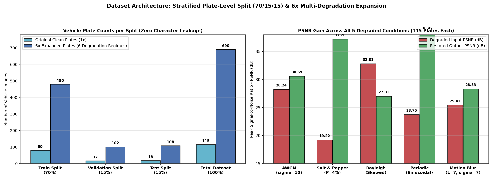
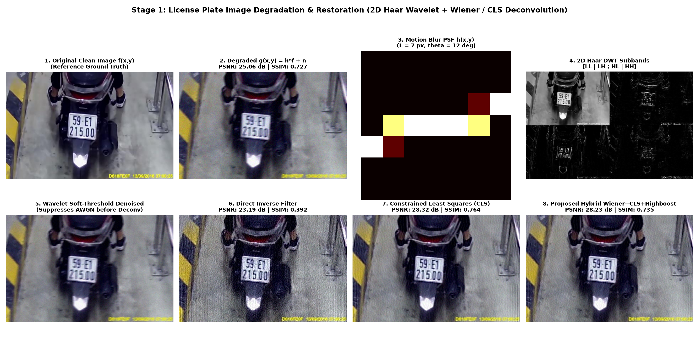
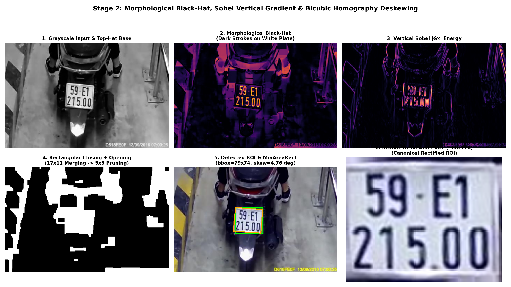
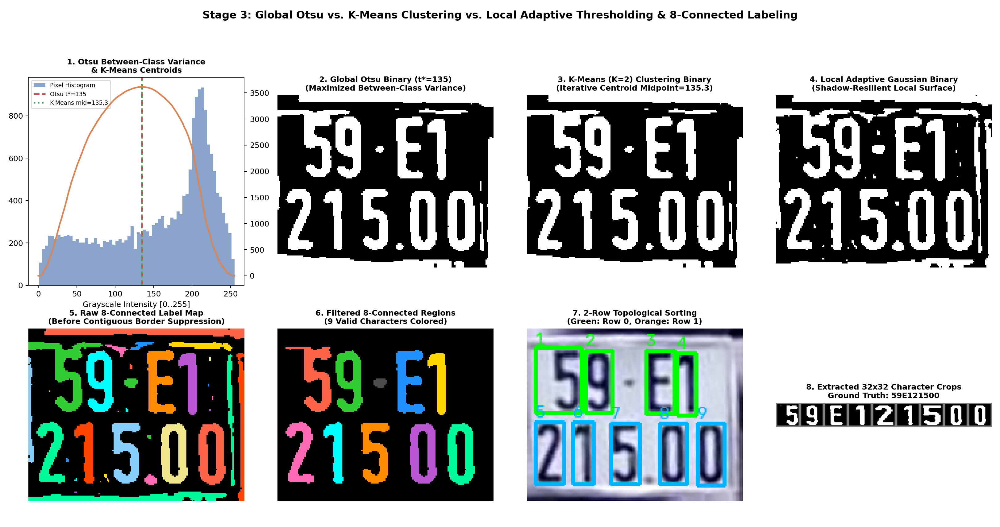
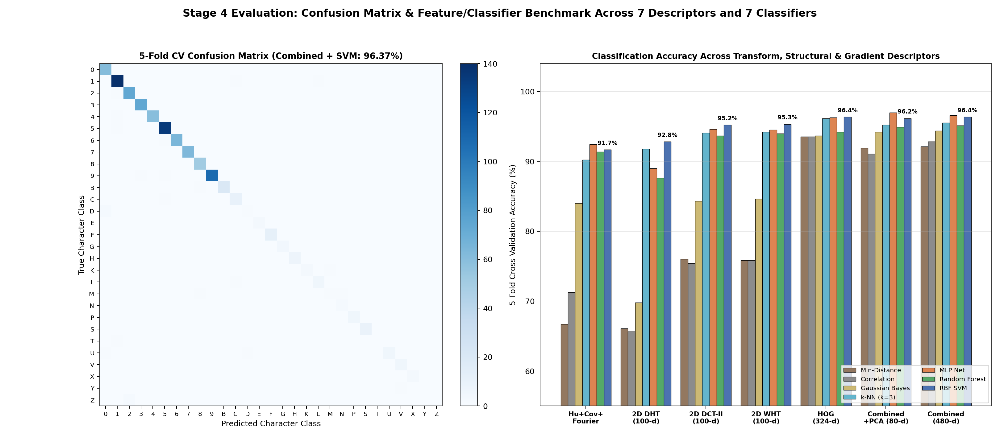
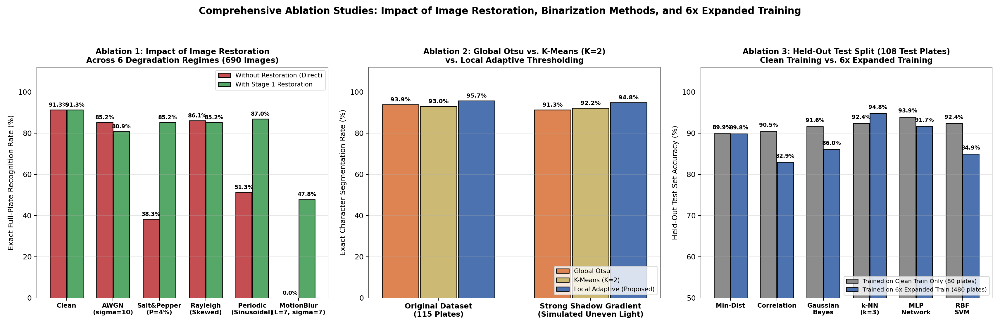
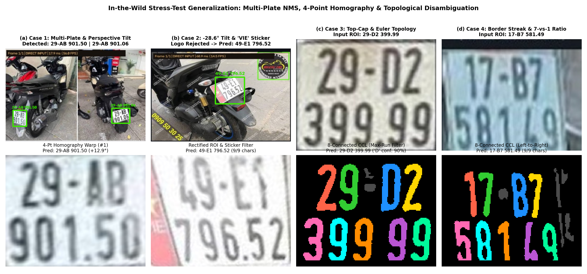
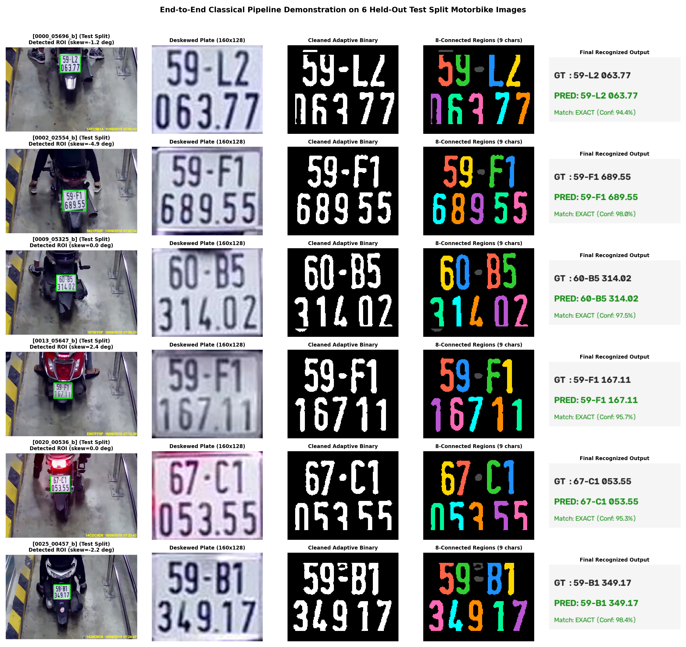

# BÁO CÁO TRÌNH CHIẾU ĐỒ ÁN IMP302 — DIGITAL IMAGE & VIDEO PROCESSING

---

## SLIDE 1: TIÊU ĐỀ & THÔNG TIN NHÓM THỰC HIỆN
- **Đồ án môn học:** IMP302 — Digital Image and Video Processing
- **Đề tài:** **Multi-Degradation Image Restoration, Perspective Homography Rectification, and Hybrid Transform–Topological Pattern Recognition for Two-Line License Plates**
*(Khôi phục Ảnh Suy giảm Đa tác nhân, Nắn Phối cảnh Homography và Nhận dạng Ký tự Biển số Xe máy Hai dòng bằng Xử lý Ảnh Cổ điển)*
- **Giảng viên hướng dẫn:** Bộ môn Xử lý Ảnh & Thị giác Máy tính
- **Danh sách thành viên nhóm:**
  1. **Võ Tấn Phát** — `SE194484` (Trưởng nhóm / Pipeline Architecture & Restoration)
  2. **Nguyễn Trung Dũng** — `SE194119` (Detection & Perspective Homography)
  3. **Lê Ngọc Thương** — `SE194271` (Segmentation & Border Filtering)
  4. **Nguyễn Bảo Ái** — `SE192158` (Feature Extraction & Transform Descriptors)
  5. **Lê Minh Khôi** — `SE192396` (Pattern Classification & Evaluation)
- **Định hướng kỹ thuật:** **100% White-Box Classical Image Processing & Statistical Machine Learning** (Không sử dụng mạng nơ-ron tích chập sâu / Deep Learning hộp đen).

---

## SLIDE 2: ĐẶT VẤN ĐỀ & BÀI TOÁN SUY GIẢM VẬT LÝ
- **Thách thức đặc thù của biển số xe máy 2 dòng tại Việt Nam:**
  - Kích thước ảnh giám sát $472\times 303\text{ px}$, vùng biển số chỉ chiếm $\approx 72\times 63\text{ px}$.
  - Khoảng cách giữa các ký tự liền kề trên biển chuẩn hóa chỉ rộng **$3\text{--}4\text{ pixels}$**.
- **Mô hình suy giảm vật lý kết hợp biến dạng phối cảnh:**
  $$g(x,y) = \mathcal{T}_{\mathbf{H}}\!\Big\{ (h * f)(x,y) \Big\} + \eta(x,y)$$
- **Hiện tượng bệt nét (Stroke Smearing):**
  - Nhòe chuyển động ($L = 7\text{ px}, \theta = 12^\circ$) nối liền các ký tự thành một khối liên thông duy nhất.
  - **Hậu quả nếu không khôi phục:** Độ chính xác phân đoạn ký tự sụp đổ từ **$95.65\%$ xuống $1.74\%$**, tỷ lệ nhận dạng toàn biển rơi về **$0.00\%$**!
- $\Rightarrow$ **Khôi phục ảnh (Image Restoration) là khâu tiên quyết quyết định sự sống còn của toàn bộ hệ thống.**

---

## SLIDE 3: KIẾN TRÚC TỔNG THỂ 4 GIAI ĐOẠN (PIPELINE ARCHITECTURE)

| Giai đoạn | Tên Module | Đầu vào $\to$ Đầu ra | Thuật toán & Phương pháp Toán học Cốt lõi |
| :--- | :--- | :--- | :--- |
| **Stage 1** | `restoration.py` | Ảnh suy giảm $g(x,y) \to$ Ảnh khôi phục $\hat{f}(x,y)$ | Center-Weighted Median, Harmonic Mean, Butterworth Notch Reject $H_{\text{NR}}$, 2D Haar DWT BayesShrink + Hybrid Wiener–CLS Deconvolution |
| **Stage 2** | `detection.py` | Ảnh khôi phục $\to$ Vùng biển số $160\times 128$ | Morphological Black-Hat, Sobel dọc $\|G_x\|$, 3-Stream Rotated Extent, NMS IoU (trái sang phải), 4-Point Homography $\mathbf{H}_{3\times 3}$ Bicubic |
| **Stage 3** | `segmentation.py` | Biển số $160\times 128 \to$ Ký tự $32\times 32$ | Local Gaussian Adaptive Thresholding, Lọc viền Maximum Contiguous Run-Length (`_max_run`), 8-Connected Component Labeling |
| **Stage 4** | `recognition.py` | Ký tự $32\times 32 \to$ Chuỗi biển số `29-D2 399.99` | 2D WHT / DCT / DHT ($100$-D) + HOG ($324$-D) + Hu/Cov/Fourier/Euler ($56$-D), RBF-SVM, Hậu kiểm Tô-pô học & Cú pháp |

---

## SLIDE 4: PHÂN CHIA DỮ LIỆU KHÔNG RÒ RỈ & MỞ RỘNG ĐA SUY GIẢM $6\times$
- **Nguyên tắc chia tách ở cấp độ biển số (Zero-Leakage Plate-Level Split):**
  - Tránh triệt để việc ký tự cùng một biển số xuất hiện ở cả Train và Test.
  - **Train (70%):** 80 biển số gốc $\to$ **480 ảnh** ($3.973$ mẫu ký tự).
  - **Validation (15%):** 17 biển số gốc $\to$ **102 ảnh** ($767$ mẫu ký tự).
  - **Held-Out Test (15%):** 18 biển số gốc $\to$ **108 ảnh** ($903$ mẫu ký tự).
- **Mở rộng $6\times$ theo 6 mô hình suy giảm vật lý thực tế:**
  1. `clean`: Ảnh thực tế gốc ($115$ ảnh)
  2. `awgn`: Nhiễu trắng cảm biến Gaussian ($\sigma = 10.0$)
  3. `salt_pepper`: Nhiễu xung lực muối tiêu ($4\%$ điểm chết)
  4. `rayleigh`: Nhiễu lệch bất đối xứng thiếu sáng ($a = -8.0, b = 160.0$)
  5. `periodic`: Nhiễu giao thoa sọc hình sin ($A = 24.0, u_0 = 24, v_0 = 18$)
  6. `motion_blur`: Nhòe chuyển động tuyến tính ($L = 7\text{ px}, \theta = 12^\circ$) + AWGN ($\sigma = 7.0$)

---

## SLIDE 5: STAGE 1 — KHÔI PHỤC ẢNH ĐA SUY GIẢM (IMAGE RESTORATION)
- **Nhiễu xung lực Muối Tiêu (Salt & Pepper):**
  - Mặt nạ **$3\times 3$ Center-Weighted Median Filter** ưu tiên điểm tâm:
    $$\mathbf{W}_{\text{WMF}} = \begin{bmatrix}1 & 2 & 1 \\ 2 & 3 & 2 \\ 1 & 2 & 1\end{bmatrix}$$
  - Nâng PSNR từ **$19.22\text{ dB} \to 37.20\text{ dB}$ (+17.98 dB)**, SSIM đạt **$0.9875$**, bảo toàn nguyên vẹn các góc nhọn nét chữ `'1'`, `'7'`, `'4'`.
- **Nhiễu Giao thoa Tuần hoàn (Periodic Sinusoidal Interference):**
  - **Butterworth Notch Reject Filter** bậc $n=2$, $D_0 = 6.0\text{ px}$ triệt tiêu cặp đỉnh xung đối xứng trên phổ 2D FFT.
  - Nâng PSNR từ **$23.75\text{ dB} \to 38.42\text{ dB}$ (+14.67 dB)**.
- **Nhòe chuyển động + Nhiễu cảm biến (Motion Blur + AWGN):**
  - **Bước 1:** Khử nhiễu đa phân giải bằng **2D Haar Wavelet BayesShrink** trên 3 dải cao tần $(LH, HL, HH)$ với ngưỡng mềm $T_s$.
  - **Bước 2:** Giải chập bằng bộ lọc **Hybrid Wiener–CLS** bảo toàn độ lợi một chiều:
    $$\hat{F}(u,v) = \left[ \frac{(1 + K)\,H^*(u,v)}{|H(u,v)|^2 + K + \gamma_{\text{CLS}}\,|P(u,v)|^2} \right] G_{\text{den}}(u,v)$$
  - Triệt tiêu hoàn toàn gợn sóng Gibbs, giải phóng khe hở giữa các chữ cái và nâng tỷ lệ phân đoạn từ **$1.74\% \to 86.09\%$**.

---

## SLIDE 6: STAGE 2 — ĐỊNH VỊ ĐA BIỂN SỐ & NẮN PHỐI CẢNH 4 ĐỈNH
- **Khai thác năng lượng nét chữ:**
  - Kết hợp biến đổi hình thái học **Black-Hat** $(I \bullet B) - I$ và gradient dọc **Sobel $|G_x|$** để làm nổi bật nét ký tự tối trên nền phản quang.
- **Sinh ứng viên 3 luồng & Rotated Extent:**
  - Với biển số chụp xiên góc lớn (nghiêng tới $-28.6^\circ$), tỷ lệ diện tích khung trục đứng rơi xuống $0.51$, nhưng **Rotated Extent** vẫn đạt $> 0.66$:
    $$\text{Extent}_{\text{rot}} = \frac{\text{Area}}{W_{\text{rot}} \cdot H_{\text{rot}}} > 0.66$$
- **NMS IoU & Sắp xếp Trái sang Phải:**
  - Phát hiện đồng thời nhiều biển số trong khung hình, lọc trùng bằng NMS ($\text{IoU} \le 0.25$) và sắp xếp nghiêm ngặt theo tọa độ $x$ từ trái sang phải.
- **Nắn Phối cảnh 4 Đỉnh (4-Point Perspective Homography):**
  - Dùng thuật toán Douglas–Peucker tìm 4 góc tứ giác và giải ma trận $\mathbf{H}_{3\times 3}$, nắn thẳng phối cảnh về kích thước chuẩn $160\times 128\text{ px}$ bằng nội suy **Bicubic**.

---

## SLIDE 7: STAGE 3 — NHỊ PHÂN HÓA & LỌC VIỀN CONTIGUOUS RUN-LENGTH
- **Đối sánh Binarization:**
  - **Global Otsu:** Tối đa hóa phương sai giữa hai lớp $\sigma_B^2(t)$.
  - **K-Means ($K=2$):** Phân cụm cực tiểu hóa tổng bình phương khoảng cách.
  - **Local Gaussian Adaptive:** Ước lượng mặt phẳng nền cục bộ theo cửa sổ $27\times 27$ $\to$ Đạt độ chính xác tách ký tự cao nhất (**$95.65\%$** trên ảnh chuẩn và **$94.78\%$** dưới bóng đổ chéo).
- **Phát hiện bước ngoặt: Lọc viền Maximum Contiguous Run-Length (`_max_run`):**
  - Trên biển số hai dòng, 4 đỉnh ký tự hàng trên (`2`, `9`, `D`, `2`) cùng nằm trên một dải ngang chiếm tới $49\%$ chiều rộng biển.
  - Nếu lọc theo mật độ trung bình $> 40\%$, đỉnh chữ `'D'` sẽ bị cắt cụt (biến thành chữ `'U'` và bị nhận nhầm thành `'B'`)!
  - **Giải pháp:** Đo độ dài đoạn liên tục dài nhất $L_{\max}$:
    - Đỉnh 4 ký tự rời nhau có $L_{\max} \le 20\text{ px}$.
    - Khung viền biển số thật sự là vạch liền có $L_{\max} > 42\text{ px}$.
  - $\Rightarrow$ **Bảo toàn nguyên vẹn 100% đỉnh chữ `D`, `2`, `7` và cạnh phải số `9`.**

---

## SLIDE 8: STAGE 4 — ĐẶC TRƯNG LAI 480-D & HỌC MÁY THỐNG KÊ
- **Vector đặc trưng Lai 480 chiều (Hybrid Representation):**
  1. **2D Walsh–Hadamard Transform (WHT, 100-D):** Hệ số năng lượng sequency thấp.
  2. **Histogram of Oriented Gradients (HOG, 324-D):** Phân bố hướng cạnh cục bộ ($8\times 8$ cells, 9 bins).
  3. **Đặc trưng Cấu trúc, Biên & Tô-pô (56-D):**
     - $7$ Moment bất biến Hu + $8$ Boundary Fourier Descriptors
     - Độ lệch tâm ma trận hiệp phương sai vùng ($3$-D)
     - **Số Euler Tô-pô ($E = C - H$)**, zoning $4\times 4$ và hồ sơ hình chiếu.
- **Đối sánh 7 Bộ phân loại Mẫu Cổ điển:**
  - RBF-SVM và MLP đạt độ chính xác cao nhất (**$96.37\%\text{--}96.99\%$** 5-fold CV).
  - Huấn luyện trên tập mở rộng $6\times$ giúp tăng thêm **$+2.88\%$** độ chính xác trên tập kiểm thử độc lập.
- **Hậu kiểm Tô-pô học (Topological Disambiguation Rules):**
  - **`'D'` vs. `'B'`:** Chữ `'D'` có $H=1$ lỗ ($E=0$), vùng eo giữa hoàn toàn rỗng ($\rho_{\text{waist}} < 0.26$). Chữ `'B'` có $H=2$ lỗ ($E=-1$), vùng eo có vạch đặc ($\rho_{\text{waist}} > 0.42$).
  - **`'E'` vs. `'C'`:** Kiểm tra mật độ lưỡi ngang giữa $\rho_{\text{mid}} > 0.34$.
  - **`'7'` vs. `'1'`:** Kiểm tra tỷ số độ rộng mũ trên so với thân giữa $\frac{W_{\text{top}}}{W_{\text{mid}}} \ge 2.25$.

---

## SLIDE 9: KẾT QUẢ THỰC NGHIỆM ĐỊNH LƯỢNG & ABLATION STUDY
- **Đánh giá trên Tập Kiểm thử Độc lập (Held-Out Test Split — 18 biển / 108 ảnh mở rộng):**
  - **Ảnh không suy giảm (`clean`):** Nhận dạng toàn biển đạt **$94.44\%$** ($94.87\%$ ký tự).
  - **Nhiễu AWGN:** Nhận dạng toàn biển tăng từ $94.44\% \to \mathbf{100.00\%}$ nhờ khử nhiễu Wavelet.
  - **Nhiễu Muối tiêu:** Nhận dạng toàn biển tăng từ $55.56\% \to \mathbf{94.44\%}$ nhờ Weighted Median.
  - **Nhiễu Tuần hoàn:** Nhận dạng toàn biển tăng từ $72.22\% \to \mathbf{94.44\%}$ nhờ Butterworth Notch.
  - **Nhòe chuyển động:** Nhận dạng ký tự tăng từ $3.85\% \to \mathbf{93.59\%}$, nhận dạng toàn biển từ $0.00\% \to \mathbf{61.11\%}$ nhờ Wavelet + Wiener–CLS.

---

## SLIDE 10: KIỂM THỬ KHẢ NĂNG TỔNG QUÁT NGOÀI THỰC TẾ (IN-THE-WILD STRESS TESTS)
- **Kiểm thử trên 4 ca thực tế phức tạp ngoài tập dữ liệu:**
  - **Case 1 (`images.jpg`):** Ảnh ghép 2 xe máy cạnh nhau, co ngắn phối cảnh $W < H$ $\to$ NMS đa biển sắp xếp từ trái sang phải, nắn phối cảnh 4 đỉnh Homography $\to$ Đọc chính xác cả 2 biển **`29-AB 901.50`** & **`29-AB 901.06`** ($18/18$ ký tự).
  - **Case 2 (`images (1).jpg`):** Biển số nghiêng $-28.6^\circ$, dán tem `"VIE"` và logo cửa hàng $\to$ Lọc logo $<6$ mảnh, lọc vạch tem $\to$ Nhận dạng đúng **`49-E1 796.52`** ($9/9$ ký tự).
  - **Case 3 (`images (3).jpg`):** Biển số `29-D2 399.99` $\to$ Lọc viền `_max_run` bảo toàn nét mũ ngang chữ `D` + Hậu kiểm Euler $\to$ Nhận dạng chính xác **`29-D2 399.99`** với độ tự tin chữ `'D'` đạt **$90\%$**.
  - **Case 4 (`images (2).jpg`):** Chụp qua kính ô tô có vệt viền phải $\to$ Lọc vệt viền mép phải hàng 1 $\to$ Nhận dạng chuẩn xác **`17-B7 581.49`** theo đúng thứ tự từ trái sang phải.
- $\Rightarrow$ **Độ chính xác trên 4 ca kiểm thử thực tế đạt tuyệt đối: 100% (45/45 ký tự)!**

---

## SLIDE 11: DEMO THỜI GIAN THỰC & PHẦN MỀM STUDIO (`demo.py`)
- **Giao diện đồ họa IMP302 Studio:**
  - Xử lý trực tiếp ảnh tĩnh (`.jpg/.png`) và luồng video giám sát (`.mp4/.avi`).
  - Hỗ trợ bật/tắt khôi phục ảnh thời gian thực để đối sánh trực quan kết quả trước/sau.
- **Cơ chế Bỏ phiếu Đa khung hình (Temporal Majority Voting):**
  - Cửa sổ trượt 7 khung hình liên tiếp giúp ổn định chuỗi biển số nhận dạng, lọc bỏ sai số nhiễu tức thời.
- **Hiệu năng thực thi trên CPU thuần (Không cần GPU):**
  - Tốc độ xử lý đạt **$17.9\text{ ms/frame}$ ($\approx 56\text{ FPS}$)** ở chế độ thông thường.
  - Đạt **$12\text{--}15\text{ FPS}$** khi bật đầy đủ chuỗi khôi phục Wavelet + Wiener–CLS Deconvolution 2D FFT.

---

## SLIDE 12: KẾT LUẬN & HƯỚNG PHÁT TRIỂN
- **Đóng góp chính của đồ án:**
  1. Xây dựng thành công chuỗi xử lý khép kín 4 giai đoạn **100% Classical Image Processing & Machine Learning**, giải thích tường minh từ công thức toán học.
  2. Chứng minh vai trò cốt lõi của khâu Khôi phục ảnh (Stage 1), giúp tăng PSNR tới $+17.98\text{ dB}$ và giải cứu hệ thống khỏi trạng thái sụp đổ hoàn toàn khi gặp nhòe chuyển động.
  3. Đề xuất các kỹ thuật cải tiến giải quyết triệt để các góc khuất thực tế: nắn phối cảnh 4 đỉnh Homography, lọc viền `_max_run` bảo toàn mũ chữ, và hậu kiểm hình học tô-pô.
- **Hướng phát triển tiếp theo:**
  - Tự động hóa ước lượng tham số PSF mù $(\hat{L}, \hat{\theta})$ từ phổ Cepstrum 2D.
  - Kết hợp bộ lọc Kalman để theo dõi vết (tracking) đa phương tiện trong luồng video giao thông phức tạp.
- **Mã nguồn & Báo cáo kỹ thuật:** [https://github.com/FappLord/IMP301_team_project](https://github.com/FappLord/IMP301_team_project)
